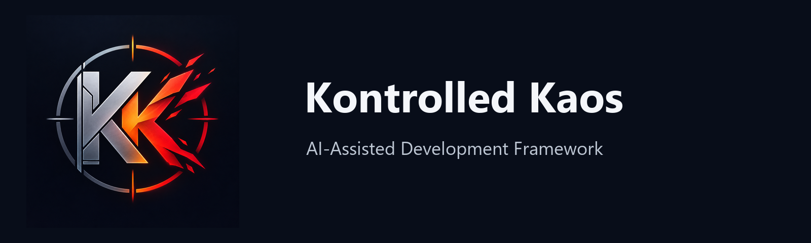

<div align="center">
  
  <p><strong>Kontrolled Kaos</strong><br />AI-Assisted Development Framework</p>
  <p><a href="docs/setup/INSTALLATION.md">Install</a> | <a href="docs/reference/README.md">Documentation</a> | <a href="docs/reference/specialists/README.md">Specialists</a> | <a href="docs/governance/README.md">Governance</a> | <a href="CHANGELOG.md">Changelog</a></p>
  <p><a href="https://github.com/Baelfyre/Kaos/releases/tag/v1.12.0"></a> <a href="https://github.com/Baelfyre/Kaos/actions/workflows/validate.yml"></a> </p>
</div>

## What is Kontrolled Kaos?

Kontrolled Kaos coordinates AI-assisted development across specialists for architecture, implementation, UI/UX, data, security, testing, documentation, and governance. It routes the task, preserves evidence, validates results, and respects human authority.

Kontrolled Kaos is **not an AI model**. It works around compatible coding hosts and does not replace engineering judgment.

## Quick start

Install through the [host installation guide](docs/setup/INSTALLATION.md). Then use the entry point documented for your host:

```text
Codex: $kaos
Antigravity: /kaos
Claude Code: /kaos:conductor

Review this repository, identify the failing tests,
fix the issue, and run relevant checks.
You may edit files and prepare a PR. Do not merge or deploy.
```

Do not assume `@Kaos` or any other invocation prefix on hosts that do not document that form.

Conductor chooses the smallest useful specialist route. [Compatibility](docs/setup/COMPATIBILITY.md) and [getting started](docs/reference/getting-started/README.md) explain supported hosts.

## Capabilities

| Area | What it provides | Important limit |
| --- | --- | --- |
| **Specialist coordination** | Focused roles, bounded execution, and handoffs | Tool access never creates permission |
| **Assurance and governance** | Evidence-based validation and human-controlled boundaries | Passing tests never authorizes a merge |
| **Security and adversarial review** | [Cipher](skills/cipher/SKILL.md) provides scoped, evidence-based source review; [Dagger](skills/dagger/SKILL.md) supports authorized adversarial validation planning | Cipher runtime and live penetration testing remain unqualified; Dagger execution requires exact target-owner authorization, Conductor routing, a non-production target, and a passing guardrail |
| **Optional visual refinement** | [Cloak](skills/cloak/SKILL.md) offers optional [8-point spacing and visual refinement](skills/cloak/VISUAL_REFINEMENT_8PT_GUIDE.md) | Advisory under project tokens, accessibility, and responsive behavior; rendered effectiveness needs rendered evidence |
| **Artifact authoring and review** | [Scribe artifact guidance](skills/scribe/ARTIFACT_AUTHORING_AND_BACKEND_SELECTION_GUIDE.md) records requirements and backend evidence; [Cloak artifact guidance](skills/cloak/ARTIFACT_VISUAL_ACCESSIBILITY_GUIDE.md) covers visual hierarchy and accessibility | Guides do not establish backend capability, output correctness, or cloud-operation authorization |
| **Adaptive memory** | Local observations, opt-in read-only context, and shadow learning | No automatic authority, preference promotion, or private cloud sync |
| **Adaptive discovery** | Scoped capability-memory contracts and offline planning | Live host discovery and trusted private-memory writes are not activated |
| **JEV advisory** | Optional TypeSafe System One advisory components | Live TypeSafe/BYOK onboarding, R3-A host trust, and production wiring remain unqualified |
| **Scribe documentation** | Requirements, as-built reconstruction, drift reconciliation, and an optional six-dimension blueprint | Scribe does not approve technical decisions or impose six mandatory files |

These are **source and maturity claims**, not a guarantee that each capability is enabled in every host.

## Feature guides

Detailed capabilities, implementation boundaries, and setup instructions are documented separately:

- [Adaptive memory and privacy](docs/setup/ADAPTIVE_MEMORY_GUIDE.md)
- [JEV offline pilot](docs/setup/JEV_OFFLINE_PILOT.md) and [local API limitations](docs/setup/JEV_LOCAL_API.md): ordinary Kaos use needs no JEV key
- [Scribe documentation and optional blueprint](docs/project/PRE_DEVELOPMENT_BLUEPRINT_GUIDE.md)
- [Cloak visual refinement](skills/cloak/VISUAL_REFINEMENT_8PT_GUIDE.md)
- [All documentation](docs/reference/README.md)

## Permissions and privacy

```text
TOOL_ACCESS != USER_AUTHORIZATION
TESTS_PASS != MERGE_APPROVAL
JEV_ADVICE != EXECUTION_AUTHORITY
MEMORY_CONFIDENCE != PERMISSION
```

No model output, learned preference, documentation matrix, or installed plugin may bypass protected decisions, transmit sensitive data without proper authority, or silently change policy.

Release governance uses a proportional [evidence-first relevance, validation, and compliance review](docs/governance/RELEASE_GATES.md): deterministic issues may be corrected and retested within granted scope, while unresolved legal, privacy, IP, authority, and final publication decisions remain governed. A machine evidence result never authorizes a release.

## More documentation

[Installation](docs/setup/INSTALLATION.md) · [MCP](docs/developer/MCP_STDIO_TRANSPORT.md) · [Architecture](docs/reference/architecture/README.md) · [Governance](docs/reference/governance/README.md) · [Developer portal](docs/developer/README.md) · [Detailed documentation map](docs/README.md) · [Machine index](README.json)

## Latest release

**[Kontrolled Kaos v1.12.0](https://github.com/Baelfyre/Kaos/releases/tag/v1.12.0)** is the latest published GitHub source/plugin release. It introduces the Kontrolled Kaos identity and updated host entry points, while retaining the existing specialists and governed workflow. See the [v1.12.0 changes and limitations](docs/reference/releases/v1.12.0.md), [release history](docs/reference/releases/README.md), and [changelog](CHANGELOG.md).

## Support

For questions and feedback, use [GitHub Discussions](https://github.com/Baelfyre/Kaos/discussions). Do not share private records, passwords, or access tokens in public discussions.

[Support development](https://buymeacoffee.com/baelfyre) · [MIT License](LICENSE)
